# Quota Float

Quota Float is a lightweight, local-first Windows/macOS desktop widget that
keeps your Codex quota visible from the Codex Desktop login already on your
machine.


> Real quota data is available in the Tauri desktop app. The browser preview
> uses mock data so the interface can be explored without a Codex login.

## What it does

Quota Float currently focuses on one provider: Codex. It reads the existing
Codex Desktop authentication state, requests the quota data needed for the
widget, and displays the result without running a proxy service or estimating
usage from local token counts.

The app can show:

- the current plan, 5-hour quota, weekly quota, and reset times;
- reset-credit count and expiration times when the quota service provides them;
- healthy, caution, critical, loading, stale, unavailable, and signed-out
  states;
- a clearly marked weekly-quota view when the 5-hour window is unavailable;
- a short-lived “recently consuming” signal when the primary remaining
  percentage drops between refreshes; and
- a local quota radar that visualizes percentage trends and gives a
  reset-aware, conservative exhaustion estimate when the sample is sufficient.
- local Codex Token activity, shown as daily, weekly, or cumulative usage from
  the desktop's dedicated session-usage records.

## Desktop features

- Compact floating orb that expands on hover.
- Dragging, edge docking, persistent expansion, and always-on-top controls.
- Click-through lock and real-time widget opacity settings.
- Optional local background image for the expanded card and compact orb.
- Provider pinning and automatic rotation infrastructure for provider-aware
  views; Codex is the only active provider today.
- Chinese and English UI/tray actions.
- System, light, dark, Sakura Night, Warm Daily Orange, City Dusk Purple, and
  Home Night appearances.
- Local quota-radar history retained for up to 30 days and clearable from the
  radar view.

The complete data boundary is documented in [PRIVACY.md](PRIVACY.md). Security
reporting guidance is in [SECURITY.md](SECURITY.md).

## Visual gallery

### Feature previews

| Healthy state | Caution state | Critical state |
| --- | --- | --- |
| 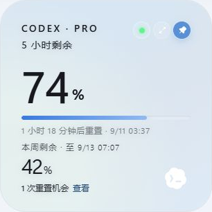 | 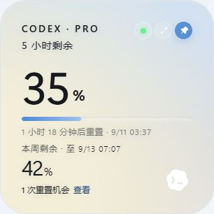 | 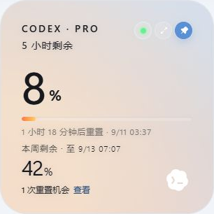 |

### Additional feature states

| Weekly quota fallback | Weekly quota orb | Reset-credit details | Quota radar |
| --- | --- | --- | --- |
| 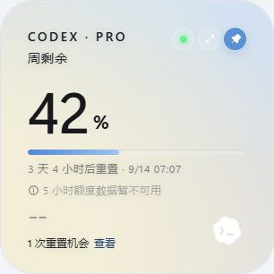 | 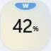 | 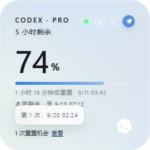 | 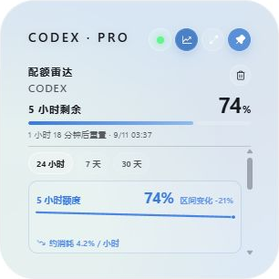 |

### Theme-applied widget

These previews are generated from the current React desktop components with
mock quota data. They show the photo-backed theme applied to the actual quota
card, rather than displaying the background asset on its own.

<table>
  <tr>
    <th>Sakura Night</th>
    <th>Warm Daily Orange</th>
    <th>City Dusk Purple</th>
    <th>Home Night</th>
  </tr>
  <tr>
    <td>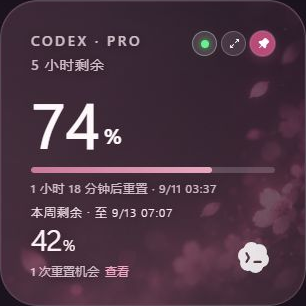</td>
    <td>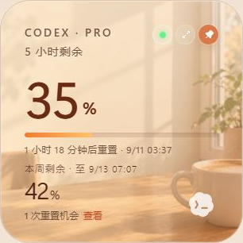</td>
    <td>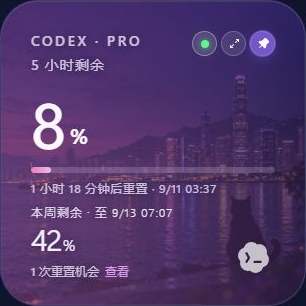</td>
    <td>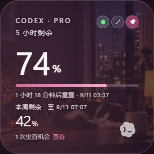</td>
  </tr>
</table>

All generated previews use mock quota values and contain no account information.

## How it works

1. Sign in to Codex Desktop on the same machine.
2. The desktop process reads `CODEX_HOME/auth.json`; when `CODEX_HOME` is not
   set, it falls back to the user's `.codex/auth.json`.
3. It sends the existing access token, plus an optional account identifier, to
   the quota endpoints used by Codex:

   - `https://chatgpt.com/backend-api/wham/usage`
   - `https://chatgpt.com/backend-api/wham/rate-limit-reset-credits`

4. It parses recognized quota windows and reset-credit fields in memory. It
   also reads only the dedicated `token_usage_record` entries under
   `CODEX_HOME/sessions` (or `.codex/sessions` when `CODEX_HOME` is unset) and
   aggregates their timestamps and cumulative totals into daily usage. It does
   not parse conversation text or tool output for this chart.
5. Within its own application data, it persists widget settings, native window
   geometry, and only the filtered percentage history used by the quota radar;
   Token activity counts remain in memory and are not uploaded or persisted.

The browser preview (`npm run dev`) returns mock snapshots and mock history; it
cannot verify a real login, network request, or desktop integration.

## Download and first run

Download the latest installer from [GitHub Releases](https://github.com/change-42-yhmm/quota-float/releases/latest):

- Windows: use the `.exe` or `.msi` installer.
- macOS: use the Universal `.dmg` bundle.

After installation:

1. Confirm that Codex Desktop is signed in.
2. Launch Quota Float. The widget starts as a compact orb and expands when you
   hover over it.
3. Use the tray menu for refresh, settings, appearance, startup, and
   quit actions.

Windows Authenticode signing and macOS Developer ID signing/notarization are
separate platform steps; a build without those certificates may still trigger
SmartScreen or Gatekeeper warnings.

For bugs, compatibility reports, and feature requests, use
[GitHub Issues](https://github.com/change-42-yhmm/quota-float/issues). Please
redact tokens, account identifiers, raw responses, local auth paths, and
personal screenshots before posting.

## Development

### Requirements

- Node.js 20 or newer
- Rust stable
- Tauri 2 system dependencies for the target platform

### Common commands

```bash
npm install
npm run dev          # Browser preview with mock data
npm run test         # Frontend tests
npm run build        # Type-check and build the web assets
npm run tauri dev    # Run the desktop app
npm run tauri build  # Build local desktop installers
```

After a Codex Desktop update, run the compatibility check from PowerShell:

```powershell
npm run check:codex
```

See [docs/CODEX-UPDATE-CHECK.md](docs/CODEX-UPDATE-CHECK.md) for the automated
compatibility workflow and optional Task Scheduler setup.

On Windows, a local Tauri build may download WiX to create an MSI. If that
download fails, the release executable may still be available at:

```text
src-tauri/target/release/quota-float.exe
```

## Project documentation

- [Privacy boundary](PRIVACY.md) — local files, network requests, persistence,
  deletion, and logging.
- [Security guidance](SECURITY.md) — safe issue reports and release checks.
- [Known limitations](docs/KNOWN-LIMITATIONS.md) — endpoint, signing, and
  platform caveats.
- [Codex update check](docs/CODEX-UPDATE-CHECK.md) — compatibility checks after
  Codex Desktop changes.
- [Contributing](CONTRIBUTING.md) — development and pull-request expectations.
- [GitHub release checklist](docs/GITHUB-RELEASE-CHECKLIST.md) — maintainer
  release flow.

## CI and releases

GitHub Actions currently provide:

- CI on pushes and pull requests: frontend tests, TypeScript/Vite build, Rust
  tests, an unsigned desktop build, and a high-severity npm audit.
- `v*` tags: Windows and macOS Universal installers and a GitHub Release draft.

Keep credentials and local artifacts out of source control. In particular, do
not commit `.codex`, `.env*`, personal screenshots, `node_modules`, `dist`,
`src-tauri/target`, or local installers.

Suggested repository description:

```text
A lightweight Windows/macOS desktop widget that keeps your Codex quota visible from your local Codex Desktop session.
```

Suggested topics:

```text
codex, quota, tauri, react, rust, desktop-app, windows, macos, productivity
```

## License

MIT
