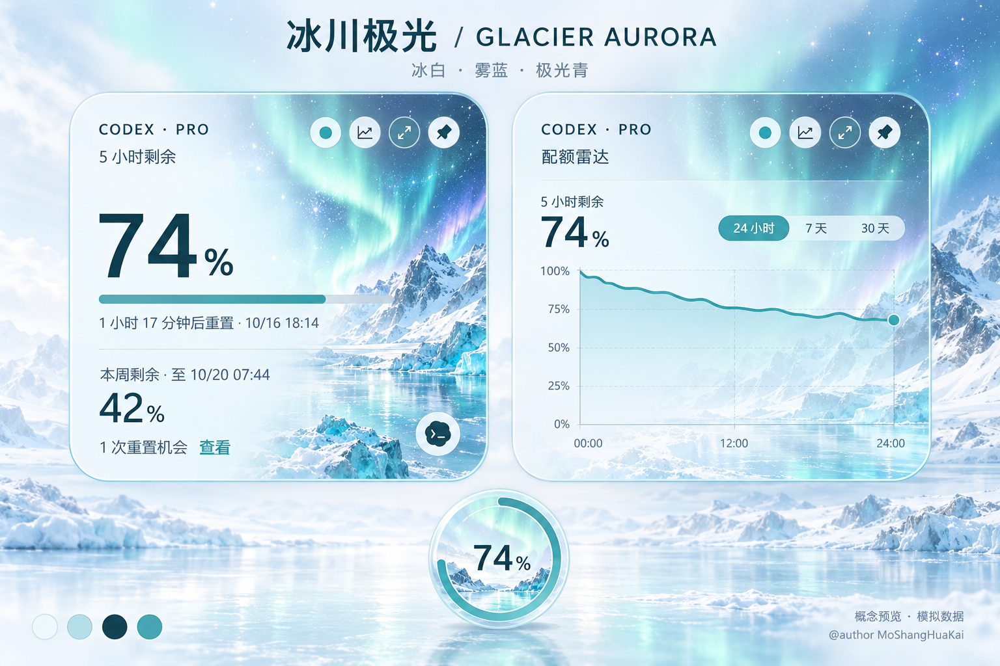
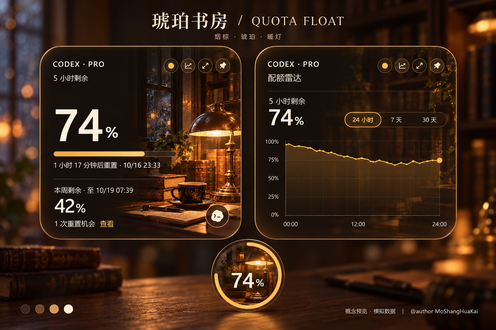
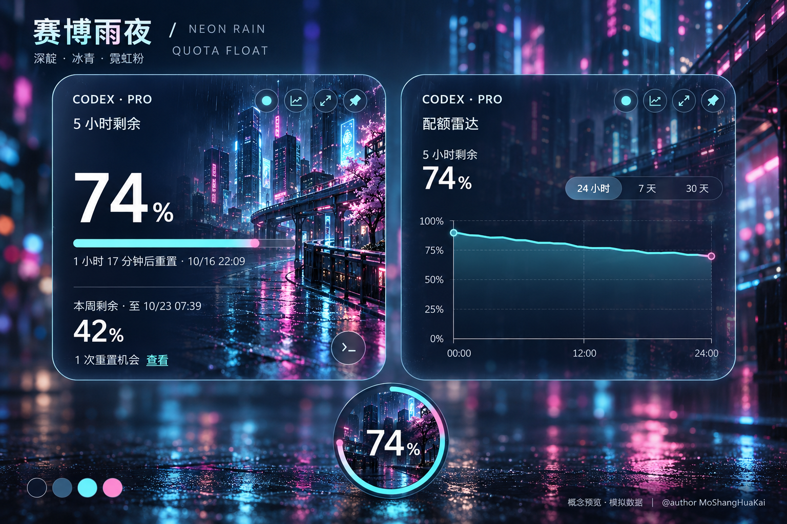

# Quota Float 主题推荐套图

@author MoShangHuaKai

日期：2026-10-16（Asia/Shanghai）

三套新主题均包含主额度卡片、额度雷达、圆形悬浮球及配色参考。使用内置 ImageGen 生成，以现有永恩、鸣人卡片截图为视觉参考。图片是设计概念，采用模拟数据，尚未接入程序。图中文字、时间、曲线坐标及填充长度为生成式示意，不能作为运行或计算验证。

## 推荐顺序

| 展示编号 | 主题 | 延续的现有方向 | 推荐理由 |
| --- | --- | --- | --- |
| 1 | 冰川极光 | 风景背景、浅色玻璃 | 冰白、雾蓝与极光青，补充现有冷色浅色主题，适合清爽桌面 |
| 2 | 琥珀书房 | 居家夜晚、温暖日常橙 | 烟棕、暖灯、奶油白文字，适合喜欢温暖安静氛围的用户 |
| 3 | 赛博雨夜 | 城市暮色紫 | 深靛、冰青与霓虹粉，适合深色桌面及科技感偏好 |

优先推荐冰川极光：与当前粉紫、暖橙、黑金方向拉开差异。三款均保留主数值、周额度、进度条、重置提示及顶部工具的信息层级。实际主卡/雷达可见尺寸为306×306，圆角38；悬浮球可见尺寸72×72，概念图按比例放大展示。

## 套图

### 1. 冰川极光



### 2. 琥珀书房



### 3. 赛博雨夜



## 生成依据

- 样式：src/styles.css 的现有尺寸、圆角、玻璃背景和明暗文字层级。
- 类型：src/types.ts 当前八种主题。
- 图像参考：vibe_images/yone-live-card.png、vibe_images/naruto-card-actual.png。
- 每套独立调用内置 ImageGen，原有概念文件保留。
- 三张输出均为1536×1024 PNG。

## 完整生成提示词

### 冰川极光

```text
Use case: ui-mockup. Create realistic, production-quality UI designs with clear hierarchy, strong typography, intentional imagery, and purposeful spacing.
Product: Quota Float, a compact desktop quota widget. Create ONE coherent theme sample suite on a 1536 x 1024 landscape presentation canvas. Current date 2026-10-16 Asia/Shanghai. Data is fictional remaining quota. Actual local source references provided: first image is existing pink-purple Yone card, second is black-gold Naruto card. Use their real compact square footprint, rounded corners and typographic data layout as grounding, not their characters. Preserve source function and density.
Each output has one single theme only, containing matched expanded card, quota radar and circular orb. A professional presentation board with top title, two equal SQUARE widgets side by side, and circular orb bottom center. Actual logical card 306x306, radius38, orb72x72, enlarge proportionally for readable presentation (panels about590x590, orb160). No browser, website, mobile phone, device frames. No cards-inside-cards. No additional products, navigation or invented metrics.
Main card hierarchy: top-left "CODEX · PRO", top-right four small circular controls (status dot, line chart, expand, pin), then "5 小时剩余"; huge left-aligned "74%"; thin progress line 74% filled; "1 小时 17 分钟后重置"; divider; "本周剩余" and "42%"; footer "1 次重置机会  查看"; terminal mark lower right. Keep left part clear, artwork focused right. Darken or lighten behind small text. Main number about twice weekly number. Respect current layout.
Radar: same square footprint, header "CODEX · PRO", controls; "配额雷达", small "5 小时剩余" with 74%, simple time options "24 小时  7 天  30 天"; single clean quota trend from95% to74%, end dot, accurate y coordinates over0%-100%; x axis00:00,12:00,24:00; no inferred burn rate. Artwork strongly subdued behind plot. Use whitespace and light dividers.
Orb: same theme art cropped, centered readable74%, arc around edge representing74% remaining. Orb should read clearly at actual compact size.
Clean Segoe UI / modern sans. Accurate simplified Chinese. Crisp text, no clipping. Presentation title includes specified theme name and QUOTA FLOAT; small four-color palette strip lower-left. Footer exact "概念预览 · 模拟数据", byline exact "@author MoShangHuaKai". No extra copy. Match theme across components, subtle glass materials and refined rim, avoid excessive glow. This is concept imagery, not software screenshots.
THEME: "冰川极光" / "GLACIER AURORA". Distinct extension of existing calm scenic glass skins into icy cool white. Palette ice porcelain #EEF6F8, glacier blue #B6DDE4, ink teal #16434D, luminous turquoise #5BAFB5.
Scene: refined painterly realistic arctic glacial lake under a pale mint aurora, snowy mountains low on right, subtle starlight, frosted crystalline reflections. No character. Main card mostly pale ice with dark teal numbers; darker cool scenic depth only far right and bottom. Beautiful misty translucent glass, restrained cyan edge. Radar very pale icy glass, teal trend line. Orb small glacier and aurora crop, clear dark number and turquoise arc. Presentation background quiet offwhite with very subtle icy landscape, ample clean margins. Mood quiet, luminous, premium, restful. Title exact "冰川极光"; short subtitle "冰白 · 雾蓝 · 极光青". Preserve pure square widgets and accessible contrast.
```

### 琥珀书房

```text
Use case: ui-mockup. Create realistic, production-quality UI designs with clear hierarchy, strong typography, intentional imagery, and purposeful spacing.
Product: Quota Float, a compact desktop quota widget. Create ONE coherent theme sample suite on a 1536 x 1024 landscape presentation canvas. Current date 2026-10-16 Asia/Shanghai. Data is fictional remaining quota. Actual local source references provided: first image is existing pink-purple Yone card, second is black-gold Naruto card. Use their real compact square footprint, rounded corners and typographic data layout as grounding, not their characters. Preserve source function and density.
Each output has one single theme only, containing matched expanded card, quota radar and circular orb. A professional presentation board with top title, two equal SQUARE widgets side by side, and circular orb bottom center. Actual logical card 306x306, radius38, orb72x72, enlarge proportionally for readable presentation (panels about590x590, orb160). No browser, website, mobile phone, device frames. No cards-inside-cards. No additional products, navigation or invented metrics.
Main card hierarchy: top-left "CODEX · PRO", top-right four small circular controls (status dot, line chart, expand, pin), then "5 小时剩余"; huge left-aligned "74%"; thin progress line 74% filled; "1 小时 17 分钟后重置"; divider; "本周剩余" and "42%"; footer "1 次重置机会  查看"; terminal mark lower right. Keep left part clear, artwork focused right. Darken or lighten behind small text. Main number about twice weekly number. Respect current layout.
Radar: same square footprint, header "CODEX · PRO", controls; "配额雷达", small "5 小时剩余" with 74%, simple time options "24 小时  7 天  30 天"; single clean quota trend from95% to74%, end dot, accurate y coordinates over0%-100%; x axis00:00,12:00,24:00; no inferred burn rate. Artwork strongly subdued behind plot. Use whitespace and light dividers.
Orb: same theme art cropped, centered readable74%, arc around edge representing74% remaining. Orb should read clearly at actual compact size.
Clean Segoe UI / modern sans. Accurate simplified Chinese. Crisp text, no clipping. Presentation title includes specified theme name and QUOTA FLOAT; small four-color palette strip lower-left. Footer exact "概念预览 · 模拟数据", byline exact "@author MoShangHuaKai". No extra copy. Match theme across components, subtle glass materials and refined rim, avoid excessive glow. This is concept imagery, not software screenshots.
THEME: "琥珀书房" / "AMBER STUDY". An elegant warm dark extension of existing Home Night and Warm Daily Orange, with smoked espresso, amber lamp light, ivory type and walnut. Palette #211B18 #684B35 #D9AA68 #F5EBDD.
Scene: painterly photoreal cozy vintage study corner at dusk, walnut bookshelves, leather-bound books, a small brass desk lamp, rainy window, faint soft dust in lamplight. No people or anime characters. Main card left half calm very dark smoked brown allowing large ivory74% typography; the warm lamp and shelves concentrated on right edge. Thin champagne-amber progress, subtle gold outline without excessive glow. Radar uniformly subdued espresso translucent glass with readable ivory text, clean amber trend. Orb a tiny brass lamp and warm book crop, cream74% and amber arc.
Presentation board is atmospheric very dark walnut with delicate warm ambient light, sparse gentle bokeh far edges, ample clean margins and no visual clutter. Very refined cozy luxurious daily desktop tool, matte glass and slight analog warmth, no steampunk gears or ornamental brass frames. Title exact "琥珀书房"; short subtitle "烟棕 · 琥珀 · 暖灯". Keep equal square panel geometry and compact existing quota layout.
```

### 赛博雨夜

```text
Use case: ui-mockup. Create realistic, production-quality UI designs with clear hierarchy, strong typography, intentional imagery, and purposeful spacing.
Product: Quota Float, a compact desktop quota widget. Create ONE coherent theme sample suite on a 1536 x 1024 landscape presentation canvas. Current date 2026-10-16 Asia/Shanghai. Data is fictional remaining quota. Actual local source references provided: first image is existing pink-purple Yone card, second is black-gold Naruto card. Use their real compact square footprint, rounded corners and typographic data layout as grounding, not their characters. Preserve source function and density.
Each output has one single theme only, containing matched expanded card, quota radar and circular orb. A professional presentation board with top title, two equal SQUARE widgets side by side, and circular orb bottom center. Actual logical card 306x306, radius38, orb72x72, enlarge proportionally for readable presentation (panels about590x590, orb160). No browser, website, mobile phone, device frames. No cards-inside-cards. No additional products, navigation or invented metrics.
Main card hierarchy: top-left "CODEX · PRO", top-right four small circular controls (status dot, line chart, expand, pin), then "5 小时剩余"; huge left-aligned "74%"; thin progress line 74% filled; "1 小时 17 分钟后重置"; divider; "本周剩余" and "42%"; footer "1 次重置机会  查看"; terminal mark lower right. Keep left part clear, artwork focused right. Darken or lighten behind small text. Main number about twice weekly number. Respect current layout.
Radar: same square footprint, header "CODEX · PRO", controls; "配额雷达", small "5 小时剩余" with 74%, simple time options "24 小时  7 天  30 天"; single clean quota trend from95% to74%, end dot, accurate y coordinates over0%-100%; x axis00:00,12:00,24:00; no inferred burn rate. Artwork strongly subdued behind plot. Use whitespace and light dividers.
Orb: same theme art cropped, centered readable74%, arc around edge representing74% remaining. Orb should read clearly at actual compact size.
Clean Segoe UI / modern sans. Accurate simplified Chinese. Crisp text, no clipping. Presentation title includes specified theme name and QUOTA FLOAT; small four-color palette strip lower-left. Footer exact "概念预览 · 模拟数据", byline exact "@author MoShangHuaKai". No extra copy. Match theme across components, subtle glass materials and refined rim, avoid excessive glow. This is concept imagery, not software screenshots.
THEME: "赛博雨夜" / "NEON RAIN". Extend existing City Dusk Purple into a mature cyan-and-magenta futuristic nighttime rain city. Palette midnight navy #0B1424, blue slate #20384C, electric cyan #56DBE6, restrained neon rose #D97BB8. Data text almost white.
Scene: richly detailed premium cinematic futuristic city skyline in rain with reflective pavement and glass towers, cyan light ribbons, tiny restrained pink signs with no readable text, deep blue-black sky. No people or anime characters. Main card left area clean midnight translucent glass, huge white74%, thin cyan progress with tiny pink highlight only at endpoint; city scene concentrated far right and bottom, tasteful softly glowing panel edge. Header controls tiny cyan line icons. Radar dark navy glass, city lights blurred and almost invisible, single cyan curve clearly legible against subtle grid. Orb compact dark city crop, white74% and cyan perimeter arc with one fine pink accent.
Presentation canvas deep midnight with hazy city bokeh mainly at outer edges and faint cyan reflections, beautiful negative space around square panels. A credible calm developer desktop widget, not a game HUD, no wireframe hexagons, no cyberpunk clutter, no chrome sci-fi ornament. Title exact "赛博雨夜"; short subtitle "深靛 · 冰青 · 霓虹粉". Keep existing rounded square footprint and clean data hierarchy. All three components share identical material and color.
```


